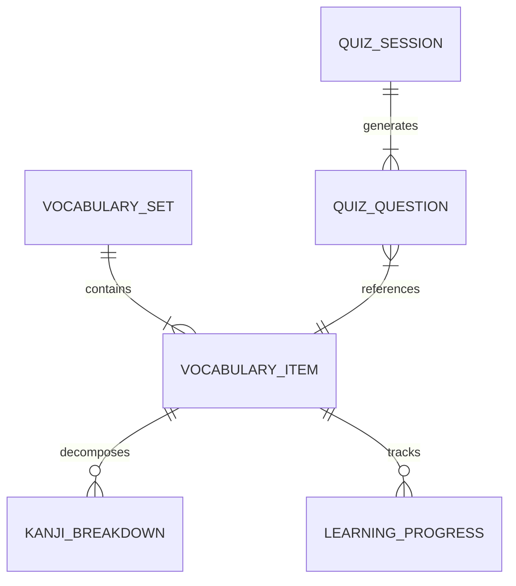

# Tango — Data Model Specification

This document defines the core data schemas, entity relationships, and client-side persistence models for Tango.

---

## 1. Core Entities



---

## 2. Vocabulary Data Model

### 2.1 TypeScript Interfaces

```typescript
/**
 * Individual Kanji character breakdown with its Sino-Vietnamese reading
 */
export interface KanjiBreakdown {
  character: string;     // Single Kanji character, e.g. "観"
  hanViet: string;       // Sino-Vietnamese reading, e.g. "QUAN"
  meaning?: string;      // Optional short Vietnamese meaning, e.g. "xem, quan sát"
}

/**
 * Individual vocabulary word entry
 */
export interface VocabularyItem {
  id: string;                    // Stable unique identifier, e.g. "vocab-chuko-1-01"
  japanese: string;              // Kanji/Kana compound, e.g. "観光客" or "ハンバーガー"
  kana: string;                  // Reading in Hiragana/Katakana, e.g. "かんこうきゃく"
  vietnamese: string[];          // List of valid Vietnamese definitions
  hanViet?: string;              // Optional compound Hán Việt, e.g. "QUAN QUANG KHÁCH"
  kanjiBreakdown?: KanjiBreakdown[]; // Optional array of Kanji component breakdowns
  tags?: string[];               // Optional semantic tags: ["N3", "noun", "lesson-1"]
}

/**
 * Cohesive collection of vocabulary (e.g. textbook chapter or custom list)
 */
export interface VocabularySet {
  id: string;                    // Unique set identifier, e.g. "set-chuko-lesson-1"
  title: string;                 // Set title, e.g. "第1課 ファストフード"
  subtitle?: string;             // Vietnamese subtitle, e.g. "Bài 1: Đồ ăn nhanh"
  group: string;                 // Group/Book name, e.g. "中級へ行こう"
  description?: string;          // Optional introductory context
  items: VocabularyItem[];       // Array of vocabulary entries
}
```

### 2.2 JSON Schema Examples

#### Example 1: Kanji Compound with Full Hán Việt & Breakdown
```json
{
  "id": "vocab-chuko-1-01",
  "japanese": "観光客",
  "kana": "かんこうきゃく",
  "vietnamese": [
    "khách tham quan",
    "khách du lịch"
  ],
  "hanViet": "QUAN QUANG KHÁCH",
  "kanjiBreakdown": [
    {
      "character": "観",
      "hanViet": "QUAN",
      "meaning": "xem, nhìn"
    },
    {
      "character": "光",
      "hanViet": "QUANG",
      "meaning": "ánh sáng, vẻ vang"
    },
    {
      "character": "客",
      "hanViet": "KHÁCH",
      "meaning": "người đến thăm"
    }
  ],
  "tags": ["N3", "noun"]
}
```

#### Example 2: Katakana Loanword (Pure Kana, No Hán Việt)
```json
{
  "id": "vocab-chuko-1-12",
  "japanese": "ハンバーガー",
  "kana": "はんばーがー",
  "vietnamese": [
    "bánh mì kẹp thịt",
    "hamburger"
  ],
  "tags": ["food", "katakana"]
}
```
*Note: Neither `hanViet` nor `kanjiBreakdown` are included. The consumer UI evaluates `if (item.hanViet)` to conditionally render the section.*

---

## 3. Quiz & Practice Session Models

The quiz engine instantiates transient question models derived from vocabulary items during an active session:

```typescript
export type QuestionType =
  | 'kana_to_kanji'      // Prompt: かんこうきゃく → Choose 観光客
  | 'kanji_to_vi'        // Prompt: 観光客 → Choose khách tham quan
  | 'vi_to_kanji'        // Prompt: khách tham quan → Choose 観光客
  | 'vi_to_text';        // Prompt: khách tham quan → Type 観光客 or かんこうきゃく

export interface QuizQuestion {
  id: string;                     // Unique question ID in session, e.g. "q-1"
  type: QuestionType;
  prompt: string;                 // The primary question text
  subPrompt?: string;             // Supplemental clue or instruction
  correctAnswer: string;          // The correct option value or expected text
  options?: string[];             // 4 choices for multiple choice questions
  targetItem: VocabularyItem;     // Full reference to the target vocabulary item
  userAnswer?: string;            // The answer submitted by user
  isCorrect?: boolean;            // Answer evaluation flag
}

export type QuizMode = 'practice' | 'test';

export interface QuizConfig {
  setId: string;                  // Set being studied
  mode: QuizMode;                 // 'practice' or 'test'
  questionCount: number | 'all';  // 10, 20, or 'all'
  allowedTypes: QuestionType[];   // Enabled question styles
}

export interface QuizSessionResult {
  sessionId: string;
  setId: string;
  mode: QuizMode;
  totalQuestions: number;
  correctCount: number;
  incorrectCount: number;
  accuracy: number;               // 0 to 100 percentage
  bestStreak: number;
  timeSpentSeconds: number;
  missedItemIds: string[];        // VocabularyItem IDs failed during this quiz
  completedAt: string;            // ISO 8601 timestamp
}
```

---

## 4. Local Learning Progress & Mistake Tracking

Tracking user retention requires a lightweight, locally persistent data structure keyed by `VocabularyItem.id`. No cloud database is required.

```typescript
export interface ItemProgress {
  itemId: string;                 // References VocabularyItem.id
  totalAttempts: number;          // Total times tested
  correctCount: number;           // Total correct responses
  incorrectCount: number;         // Total mistakes made
  lastMistakeAt?: string;         // ISO timestamp of last incorrect response
  lastStudiedAt: string;          // ISO timestamp of last interaction
  isMarkedWeak: boolean;          // True if incorrectCount / totalAttempts > 0.3
}

export interface UserStudyState {
  version: number;                // Schema version for future migrations (e.g. 1)
  progressByItem: Record<string, ItemProgress>;
  recentResults: QuizSessionResult[];
}
```

### Concept of Operation:
1. **Mistake Identification:** Whenever a user answers incorrectly, `progressByItem[itemId].incorrectCount` increments, and `isMarkedWeak` becomes `true`.
2. **Review Missed Words Trigger:** Clicking "Review Missed Words" at the end of a quiz filters the set for `missedItemIds` and builds a high-focus practice session exclusively targeting those items.
3. **Recovery:** Answering a weak word correctly in 2 consecutive sessions unmarks `isMarkedWeak`.
