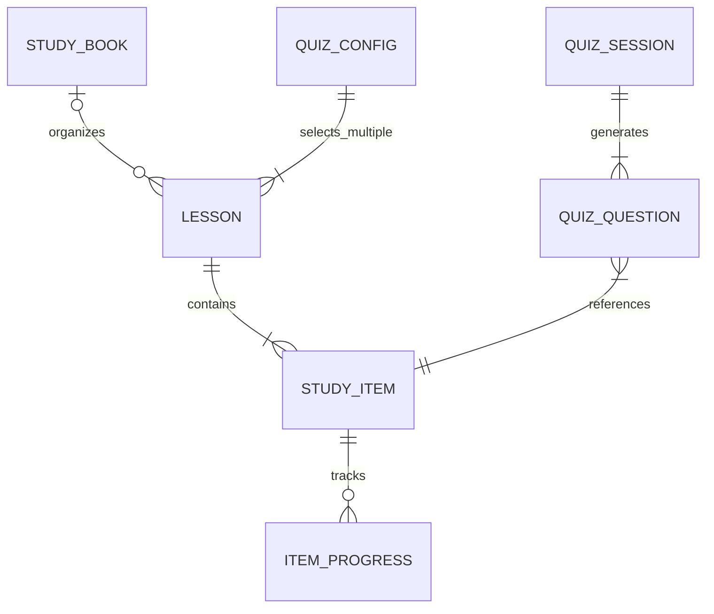

# Tango — Data Model Specification

This document defines the core data schemas, TypeScript interfaces, and client-side persistence models for Tango.

---

## 1. Architectural Entity Relationship

Vocabulary and Kanji lessons share the exact same item structure and feed into a single unified quiz engine. Study Books act as optional organizational containers above lessons (see [`docs/CONTENT_LIBRARY_SPEC.md`](./CONTENT_LIBRARY_SPEC.md)).



*Cardinality Note: One `StudyBook` organizes zero or many `Lesson`s (`o{`). One `Lesson` belongs to zero or one `StudyBook` (`|o`). Lessons without a `bookId` belong to the neutral group `Không thuộc giáo trình` (Unassigned).*

---

## 2. Core Study Models: StudyBook, Lesson, & StudyItem

### 2.1 TypeScript Interfaces

```typescript
/**
 * Category distinguishing the curriculum area.
 * Vocabulary and Kanji share the identical item schema and quiz engine.
 */
export type StudyCategory = 'vocabulary' | 'kanji';

/**
 * Organizational container representing a textbook or curriculum.
 * See docs/CONTENT_LIBRARY_SPEC.md for complete specifications.
 */
export interface StudyBook {
  id: string;              // Opaque collision-safe unique ID (e.g. "book_" + crypto.randomUUID())
  title: string;           // Display title, e.g. "中級へ行こう" (Required, non-empty; duplicates allowed)
  coverImageId?: string;   // Reference ID for cover binary Blob in IndexedDB (Optional)
  createdAt: string;       // ISO 8601 creation timestamp
  updatedAt: string;       // ISO 8601 last modified timestamp
}

/**
 * ID & Title Independence Rules:
 * - StudyBook IDs are opaque, collision-safe identifiers (e.g. generated via browser crypto.randomUUID()).
 * - IDs are NEVER derived from the title. Renaming a book never alters its id or breaks Lesson.bookId links.
 * - Duplicate titles are explicitly permitted (learners may track separate volumes or editions).
 * - User-created lessons/items also receive opaque collision-safe IDs; bundled seed files use stable IDs.
 */

/**
 * Shared core study item for both Vocabulary and Kanji lessons.
 * Fully synchronized with forgiving import rules (see docs/IMPORT_SPEC.md).
 */
export interface StudyItem {
  id: string;              // Stable unique identifier, e.g. "kanji-01-001" or "vocab-01-001"
  japanese: string;        // Japanese word/compound, e.g. "旅行" or "ファストフード" (Required)
  kana?: string;           // Optional reading in Hiragana/Katakana, e.g. "りょこう" or "ふぁすとふーど"
  hanViet?: string;        // Optional Sino-Vietnamese reading, e.g. "LỮ HÀNH" (omitted for loanwords)
  vietnamese: string[];    // Array of accepted Vietnamese definitions (allowed to be empty [])
}

/**
 * Standard Lesson container used for both Vocabulary and Kanji categories.
 * May optionally belong to a StudyBook via bookId.
 */
export interface Lesson {
  id: string;              // Unique lesson ID, e.g. "vocab-lesson-01" or "kanji-lesson-01"
  bookId?: string;         // Optional reference to StudyBook.id (unassigned lessons remain valid)
  category: StudyCategory; // 'vocabulary' | 'kanji'
  title: string;           // Display title, e.g. "Bài 1"
  subtitle?: string;       // Optional subtitle, e.g. "Đồ ăn nhanh" or "Giao thông & Đi lại"
  items: StudyItem[];      // Flat list of study items
}
```

### 2.2 JSON Schema Examples

#### Example 1: Kanji Lesson Item (with Hán Việt)
```json
{
  "id": "kanji-lesson-01-001",
  "japanese": "旅行",
  "kana": "りょこう",
  "hanViet": "LỮ HÀNH",
  "vietnamese": ["du lịch"]
}
```

#### Example 2: Vocabulary Lesson Item without Hán Việt (Loanword)
```json
{
  "id": "vocab-lesson-01-001",
  "japanese": "ファストフード",
  "kana": "ふぁすとふーど",
  "vietnamese": ["đồ ăn nhanh"]
}
```
*Rule: When `hanViet` is omitted, UI components check `if (item.hanViet)` and conditionally omit the Hán Việt block entirely.*

#### Example 3: Full Lesson File (`src/data/kanji/lesson-01.json`)
```json
{
  "id": "kanji-lesson-01",
  "category": "kanji",
  "title": "Bài 1",
  "subtitle": "Hành động & Đi lại",
  "items": [
    {
      "id": "kanji-01-001",
      "japanese": "旅行",
      "kana": "りょこう",
      "hanViet": "LỮ HÀNH",
      "vietnamese": ["du lịch"]
    },
    {
      "id": "kanji-01-002",
      "japanese": "実際",
      "kana": "じっさい",
      "hanViet": "THỰC TẾ",
      "vietnamese": ["thực tế"]
    },
    {
      "id": "kanji-01-003",
      "japanese": "礼儀",
      "kana": "れいぎ",
      "hanViet": "LỄ NGHI",
      "vietnamese": ["lễ nghi", "phép lịch sự"]
    },
    {
      "id": "kanji-01-004",
      "japanese": "景観",
      "kana": "けいかん",
      "hanViet": "CẢNH QUAN",
      "vietnamese": ["cảnh quan"]
    }
  ]
}
```

---

## 3. Quiz & Practice Session Models

### 3.1 Multi-Lesson Quiz Configuration

Tango supports testing any arbitrary set of lessons—single lesson, multi-lesson, or a mixed test across Vocabulary and Kanji:

```typescript
export type QuestionType =
  | 'kana_to_japanese'   // Prompt: りょこう → Choose 旅行
  | 'japanese_to_vi'     // Prompt: 旅行 → Choose du lịch
  | 'vi_to_japanese'     // Prompt: du lịch → Choose 旅行
  | 'vi_to_text';        // Prompt: du lịch → Type 旅行 or りょこう

export type QuizMode = 'practice' | 'test';

export interface QuizConfig {
  lessonIds: string[];            // Array of selected lesson IDs (supports 1 to N lessons)
  mode: QuizMode;                 // 'practice' or 'test'
  questionCount: number | 'all';  // Candidate fixed counts (10, 20, 40) or 'all'
  allowedTypes: QuestionType[];   // Enabled question formats
}
```

### 3.2 Question Count & Pool Generation Rules
- **Definition of `questionCount: 'all'`:** After aggregating lessons and deduplicating by `normalized(japanese) + '::' + normalized(kana || '')`, every eligible unique `StudyItem` appears **exactly once** in the initial question set.
  - It does **NOT** multiply by the number of enabled question types (e.g. 52 eligible items = 52 initial questions, never 52 × 4 = 208).
  - For each unique item, exactly ONE enabled compatible question type is selected.
  - Missing data skips incompatible types: an item with no `kana` skips `kana_to_japanese`; an item with empty `vietnamese` definitions skips `japanese_to_vi`, `vi_to_japanese`, and `vi_to_text`. If an item supports none of the enabled question types, it is excluded.
  - `Tất cả (N)` / `All (N)` always displays the exact count of eligible unique items (`N`), not raw source item counts.
  - *Practice Mode Note:* In Practice Mode, missed items may be re-queued after the initial question set until answered correctly, so total interactions in the session may exceed `N`.
- **Dynamic Fixed Count Options:** Candidate fixed numbers are `10`, `20`, `40`. The UI only displays fixed counts that are `<= N`.
  - Example `N = 7`: `[ Tất cả (7) ]`
  - Example `N = 16`: `[ 10 ]  [ Tất cả (16) ]`
  - Example `N = 27`: `[ 10 ]  [ 20 ]  [ Tất cả (27) ]`
  - Example `N = 81`: `[ 10 ]  [ 20 ]  [ 40 ]  [ Tất cả (81) ]`
  - Disabled or impossible count buttons are never rendered.

> **Cross-Category Pool Deduplication:** When building the study question pool from multiple lessons, items are deduplicated using `normalized(japanese) + '::' + normalized(kana || '')` to ensure the same word appearing in both Vocabulary and Kanji is not tested redundantly.

### 3.3 Active Question & Session State

```typescript
export interface QuizQuestion {
  id: string;                     // Question identifier in session, e.g. "q-1"
  type: QuestionType;
  prompt: string;                 // The prompt string displayed
  subPrompt?: string;             // Optional reading aid or instruction
  correctAnswer: string;          // Correct choice text or expected input
  options?: string[];             // 4 choices for multiple choice questions
  targetItem: StudyItem;          // Full reference to the underlying StudyItem
  userAnswer?: string;            // Answer submitted by learner
  isCorrect?: boolean;            // Evaluation flag
}

export interface QuizSessionResult {
  sessionId: string;
  lessonIds: string[];            // IDs of lessons included in this session
  mode: QuizMode;
  totalQuestions: number;
  correctCount: number;
  incorrectCount: number;
  accuracy: number;               // 0 to 100 percentage
  bestStreak: number;
  timeSpentSeconds: number;
  missedItemIds: string[];        // StudyItem IDs failed during this quiz
  completedAt: string;            // ISO 8601 timestamp
}
```

---

## 4. Local Learning Progress & Persistence Architecture

Tracking user retention is handled via a unified, client-side store keyed by `StudyItem.id`. Because Vocabulary and Kanji items use the same item schema and ID convention, progress tracking is completely uniform.

```typescript
export interface ItemProgress {
  itemId: string;                 // References StudyItem.id
  totalAttempts: number;          // Total times tested
  correctCount: number;           // Times answered correctly
  incorrectCount: number;         // Times answered incorrectly
  lastMistakeAt?: string;         // ISO timestamp of last incorrect response
  lastStudiedAt: string;          // ISO timestamp of last interaction
  isMarkedWeak: boolean;          // Flagged if error rate exceeds threshold
}

export type AppTheme = 'light' | 'dark' | 'sakura';
export type AppLanguage = 'vi' | 'en';

export interface UserPreferences {
  theme: AppTheme;               // 'light' (default) | 'dark' | 'sakura'
  language: AppLanguage;         // 'vi' (default) | 'en'
  soundEnabled: boolean;         // Default: false (strictly OFF until user enables)
}

/**
 * Aggregated runtime client-side state in TypeScript memory.
 * Physical persistence is partitioned across dedicated storage keys.
 */
export interface UserStudyState {
  version: number;                // Schema version for future migrations
  preferences: UserPreferences;
  books: Record<string, StudyBook>; // All textbooks keyed by StudyBook.id
  lessons: Record<string, Lesson>;  // Canonical mutable Lesson store
  progressByItem: Record<string, ItemProgress>;
  recentResults: QuizSessionResult[];
}
```

### 4.1 Physical Storage Keys (Partitioned Persistence)
`UserStudyState` is an aggregated in-memory model. Browser storage is intentionally partitioned across distinct keys:
- `tango_v1_books`: `Record<string, StudyBook>` in `localStorage`
- `tango_v1_lessons`: Canonical mutable `Record<string, Lesson>` in `localStorage` (all seeded, imported, and user-created lessons)
- `tango_v1_progress`: `Record<string, ItemProgress>` in `localStorage`
- `tango_v1_history`: `QuizSessionResult[]` in `localStorage`
- `tango_v1_preferences`: `UserPreferences` in `localStorage`
- `tango_v1_library_init`: Initialization marker in `localStorage` ensuring bundled seed data is copied only once
- `tango_v1_covers_idb`: Binary book cover `Blob`s in browser IndexedDB (object store)

### 4.2 Deterministic Quiz History Cleanup Rule
When a lesson or StudyBook is permanently deleted, any `QuizSessionResult` in `tango_v1_history` that references any of the affected lesson IDs or item IDs is **deleted entirely**. Preserving partial or incomplete summaries with missing lesson context would corrupt score and accuracy records. Unaffected quiz histories remain untouched.

### 4.3 Mistake Review Lifecycle
1. When any question is answered incorrectly, `targetItem.id` is added to `QuizSessionResult.missedItemIds`.
2. Clicking **"Ôn lại từ sai" (Review Missed Words)** gathers the corresponding `StudyItem` records across all tested lessons and launches a focused practice session exclusively for those items.
3. Once an item is answered correctly in subsequent review sessions, `isMarkedWeak` is cleared.
