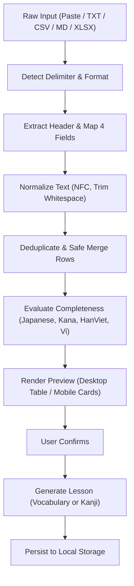

# Tango — Lesson Import Specification

This document defines the authoritative functional specification, parsing rules, UX workflows, and error-handling principles for Tango's lesson import system.

---

## 1. Purpose & Core Study Workflow

Lesson import is a core, first-class capability of Tango rather than a secondary developer utility. 

### The Real-World Learning Workflow
```
Teacher provides vocabulary list
             ↓
User prepares, copies, or downloads the data
             ↓
User pastes text or uploads a file into Tango
             ↓
Tango parses & normalizes content automatically
             ↓
User inspects the visual Preview
             ↓
Tango highlights missing fields (warnings, non-blocking)
             ↓
Tango automatically deduplicates & safely merges rows
             ↓
User confirms → Lesson created (Vocabulary or Kanji)
             ↓
User immediately begins Practice, Quick Test, or Mixed Test
```

### Design Tenets
- **Fast:** Instant client-side parsing without server round-trips.
- **Forgiving:** Automatically fixes what is safe, strips duplicates, and allows imperfect data to be imported.
- **Human-Centric:** Simple terminology in Vietnamese; does not feel like an engineering CSV/ETL tool.
- **Dual-Platform:** Fully optimized for mobile phone touchscreens as well as desktop browsers.

---

## 2. One Importer for Both Categories & All Study Books

Tango features two study categories:
- **[IconBook] Từ vựng (Vocabulary)**
- **[IconWriting] Hán tự (Kanji)**

Both categories share the identical `StudyItem` schema. Consequently, **there is only one unified importer**.

```text
Giáo trình
[ 中級へ行こう ▼ ]

Loại bài học
[ [IconBook] Từ vựng ]   [ [IconWriting] Hán tự ]
```

- Selecting the book sets `Lesson.bookId` (or leaves it undefined for `Không thuộc giáo trình`).
- Selecting the category assigns the `category: 'vocabulary' | 'kanji'` attribute on the resulting `Lesson`.
- The parser, delimiter detector, header mapper, duplicate engine, and preview interface remain **100% identical**.
- **Safe Administrative Access:** The importer is launched from **Settings → Quản lý nội dung (Content Management)**, protecting the Home screen from accidental clicks (see [`docs/CONTENT_LIBRARY_SPEC.md`](./CONTENT_LIBRARY_SPEC.md)).
- **Anti-pattern:** Never implement separate `VocabularyImporter` and `KanjiImporter` modules.

---

## 3. Core Study Item Columns & Schema Alignment

### 3.1 Four Core Columns

Imported data maps into four conceptual columns:

| Column (EN) | Cột hiển thị (VI) | Description | Example |
|---|---|---|---|
| **Japanese** | Từ vựng | Japanese expression (Kanji/Kana compound) | 日本を訪れる / 旅行 / ファストフード |
| **Kana** | Cách đọc | Hiragana / Katakana reading | にほんをおとずれる / りょこう / ふぁすとふーど |
| **Hán Việt** | Âm Hán Việt | Sino-Vietnamese reading (optional) | Nhật Bản Phỏng / Lữ Hành |
| **Vietnamese** | Nghĩa tiếng Việt | Vietnamese definition(s) | Đến thăm Nhật Bản / Du lịch, chuyến đi |

### 3.2 Canonical `StudyItem` Model Synchronization

The canonical definition in [`docs/DATA_MODEL.md`](./DATA_MODEL.md) is fully synchronized with the forgiving import requirements:

```typescript
export interface StudyItem {
  id: string;              // Stable unique identifier
  japanese: string;        // Japanese expression (Required)
  kana?: string;           // Optional reading in Hiragana/Katakana
  hanViet?: string;        // Optional Sino-Vietnamese reading (omitted for loanwords)
  vietnamese: string[];    // Array of accepted Vietnamese definitions (allowed to be empty [])
}
```

This synchronization ensures:
1. Items lacking a Kana reading or Vietnamese meaning can be imported without type conflicts.
2. Missing Kana or Vietnamese definitions trigger non-blocking warnings (`⚠`) in the import preview.
3. The quiz engine gracefully skips question types that require the missing field(s) for that item.

---

## 4. Missing Data Philosophy

Tango adopts a **forgiving, non-blocking** approach to imperfect input data:

```
Missing Field          Severity      Behavior
─────────────────────────────────────────────────────────────────────────────
Japanese expression    BLOCKING      Row ignored or marked invalid. Cannot study
                                     without the core Japanese expression.
Kana reading           WARNING (⚠)   Non-blocking. Warning shown in preview.
                                     Quiz skips Kana-based questions for this item.
Hán Việt               SILENT        Normal occurrence (e.g. Katakana/loanwords).
                                     No warning displayed; section hidden in UI.
Vietnamese meaning     WARNING (⚠)   Non-blocking. Warning shown in preview.
                                     Quiz skips meaning-based questions for this item.
```

- **Non-blocking Warnings:** Warnings (`⚠`) inform the learner of missing information, but the **"Thêm bài" (Add Lesson)** button remains fully active.
- **Zero Fabrication:** Tango **never** hallucinates, fabricates, or auto-generates missing readings or definitions without user consent.
- **Quiz Adaptation:** The shared quiz engine inspects each item's available fields and dynamically emits only valid question types.

---

## 5. Supported Input Methods

The importer provides two equal entry options:

### 5.1 Method A: Paste Data (Dán dữ liệu)
A clean, responsive `<textarea>` supporting direct pasting of copied text from spreadsheets, notes, web pages, or messaging apps.
- Auto-expands or scrolls smoothly on both mobile and desktop.
- Retains UTF-8 Japanese and Vietnamese characters without encoding corruption.

### 5.2 Method B: Upload File (Chọn file)
Uses standard HTML5 File API for local, client-side reading:
- Supported extensions: `.txt`, `.csv`, `.md`, `.xlsx`
- Required supported targets across standard file pickers on Windows, macOS, Android, and iOS that must be validated during implementation and testing.
- **100% Client-Side:** Files are parsed in-memory in the browser. Zero server upload, zero backend required.

---

## 6. Delimiter Support & CSV Handling

### 6.1 Supported Delimiters
- **Tab (`\t`):** Default for copied spreadsheet rows from Excel or Google Sheets.
- **Semicolon (`;`):** Common European and textbook export format.
- **Pipe (`|`):** Clean format frequently used in markdown and notes.
- **Comma (`,`):** Standard CSV format.
- **Custom:** User-specified character.

```text
Phân cách cột
[ Tự động ▼ ]
  • Tự động (khuyên dùng)
  • Tab
  • Chấm phẩy ( ; )
  • Dấu gạch đứng ( | )
  • Dấu phẩy ( , )
  • Ký hiệu khác...
```

### 6.2 Intelligent Auto-Detection
The default mode is `Tự động`. The detector evaluates consistency across the first 10 rows using a weighted preference hierarchy:
1. `Tab` (highest certainty in copy-paste)
2. `Semicolon (;)`
3. `Pipe (|)`
4. `Comma (,)` (lowest priority due to natural language commas)

A delimiter is only selected if it splits rows with uniform column counts across multiple lines.

### 6.3 Robust RFC 4180 CSV / Comma Handling
Vietnamese definitions routinely contain commas:
```text
旅行,りょこう,Lữ Hành,"Du lịch, chuyến đi"
```
- The parser **never** performs a naive `.split(',')`.
- It implements standard RFC 4180 CSV parsing, respecting double quotes `""` around fields containing commas or linebreaks.

---

## 7. Header Detection & Column Mapping

The importer intelligently handles input **with or without** a header row.

### 7.1 Header Alias Recognition
The parser checks the first non-empty row against known column aliases (case-insensitive, diacritic-tolerant):

| Target Field | Recognized Header Aliases |
|---|---|
| **Japanese** | `Từ vựng`, `Tu vung`, `Japanese`, `Word`, `Kanji`, `日本語`, `単語` |
| **Kana** | `Cách đọc`, `Cach doc`, `Kana`, `Hiragana`, `Reading`, `ひらがな`, `かな` |
| **Hán Việt** | `Âm Hán Việt`, `Hán Việt`, `Han Viet`, `Am Han Viet`, `Hán tự` |
| **Vietnamese** | `Nghĩa tiếng Việt`, `Nghĩa`, `Nghia`, `Vietnamese`, `Meaning`, `Ý nghĩa` |

If a row matches at least 2 known headers, it is treated as a header row and removed from study items.

### 7.2 Positional Fallback (No Header)
If no recognizable header is found, the parser assigns columns in standard order:
```text
Column 1: Japanese
Column 2: Kana
Column 3: Hán Việt
Column 4: Vietnamese Meaning
```

A compact manual mapping selector is accessible in Preview if auto-mapping requires adjustment.

---

## 8. Markdown Table Import

The importer natively extracts data from standard Markdown tables:

```markdown
| Từ vựng | Cách đọc | Âm Hán Việt | Nghĩa tiếng Việt |
|---|---|---|---|
| 日本を訪れる | にほんをおとずれる | Nhật Bản Phỏng | Đến thăm Nhật Bản |
| 旅行 | りょこう | Lữ Hành | Du lịch, chuyến đi |
```

- Strips outer pipes `|`.
- Automatically recognizes and ignores Markdown separator rows (e.g. `|---|:---|---:|`).

---

## 9. Excel (.xlsx) Import

For `.xlsx` spreadsheet uploads:
- Reads the **first usable worksheet**.
- Automatically locates the first non-empty header row.
- Ignores completely blank rows and styling.
- *Implementation note:* Parsed client-side via a lightweight spreadsheet parser when implemented; no server needed.

---

## 10. Duplicate Handling & Safe Merging

Learners frequently paste overlapping lesson materials. Duplicates must be resolved automatically without manual pre-cleaning.

### 10.1 Normalization Prior to Comparison
Before comparison, fields are normalized:
- Leading/trailing whitespace trimmed.
- Unicode normalized to `NFC` (`String.prototype.normalize('NFC')`).
- Internal spaces collapsed.
- Comparison key: `normalized(japanese) + '::' + normalized(kana || '')`.

### 10.2 Exact Duplicates
Exact matching rows are deduplicated automatically:
```text
Row 1: 旅行;りょこう;Lữ Hành;Du lịch
Row 2: 旅行;りょこう;Lữ Hành;Du lịch
→ Result: 1 StudyItem
→ Notification: "✓ Đã tự loại bỏ 1 dòng trùng"
```

### 10.3 Complementary Duplicates (Safe Merge)
When duplicate entries supply complementary non-empty fields, Tango merges them:
```text
Row 1: 旅行;りょこう;Lữ Hành;
Row 2: 旅行;りょこう;;Du lịch
→ Merged Result: 旅行;りょこう;Lữ Hành;Du lịch
→ Notification: "✓ Đã tự gộp 1 mục bổ sung thông tin"
```

### 10.4 Conflicting Duplicates
If two matching keys contain conflicting non-empty definitions or readings:
- Tango does **not** silently invent a resolution or overwrite data blindly.
- It keeps one canonical item (the first encountered valid entry).
- It clearly surfaces a conflict warning badge (`⚠ Xung đột dữ liệu`) in the Preview interface so the user is informed.

---

## 11. Desktop Preview Interface

Before saving, a clear summary and table are displayed:

```text
XEM TRƯỚC — Bài 1: Giao thông & Đi lại

[ 39 mục sẵn sàng ]  [ 2 mục thiếu thông tin ⚠ ]  [ 3 dòng trùng đã tự loại bỏ ✓ ]

┌────┬──────────────┬────────────┬──────────────┬────────────────────────┬────────┐
│ #  │ Từ vựng      │ Cách đọc   │ Âm Hán Việt  │ Nghĩa tiếng Việt       │ Trạng  │
├────┼──────────────┼────────────┼──────────────┼────────────────────────┼────────┤
│ 1  │ 日本を訪れる │ にほん...  │ Nhật Bản...  │ Đến thăm Nhật Bản      │  ✓     │
│ 2  │ 美しい       │            │ Mỹ           │ Đẹp                    │  ⚠     │
│ 3  │ 旅行         │ りょこう   │ Lữ Hành      │ Du lịch, chuyến đi     │  ✓     │
│ 4  │ ファスト...  │ ふぁすと.. │              │ Đồ ăn nhanh            │  ✓     │
└────┴──────────────┴────────────┴──────────────┴────────────────────────┴────────┘

⚠ Cảnh báo không ngăn việc thêm bài học.

[ Quay lại chỉnh sửa ]                                 [ Thêm 39 mục vào Hán tự ]
```

---

## 12. Mobile Preview Interface

On mobile screens, four-column tables cause horizontal scroll frustration. Tango replaces the table with **responsive stacked preview cards**:

```text
┌──────────────────────────────────────────────┐
│  Mục 2 / 39                             ⚠    │
│                                              │
│  美しい                                      │
│                                              │
│  Cách đọc:     — (⚠ Chưa có cách đọc)        │
│  Âm Hán Việt:  Mỹ                            │
│  Nghĩa:        Đẹp                           │
└──────────────────────────────────────────────┘
```

- Each card displays clear badges for missing fields.
- Large, thumb-friendly action buttons anchored at the bottom:
  - `[ Quay lại ]` (Secondary)
  - `[ Thêm 39 mục vào bài ]` (Primary, height 52px)

---

## 13. Import Screen UX Flow

```text
THÊM BÀI HỌC MỚI

1. Chọn giáo trình
   [ 中級へ行こう ▼ ]
   (Danh sách giáo trình hiện có + "Không thuộc giáo trình")

2. Chọn phân loại
   [ [IconBook] Từ vựng ]   [ [IconWriting] Hán tự ]

3. Tên bài học
   [ Bài 1: Giao thông & Đi lại                ]

4. Phương thức nhập
   [ Dán văn bản ]   [ Tải file lên ]

5. Phân cách cột
   [ Tự động ▼ ]

┌──────────────────────────────────────────────┐
│ Dán danh sách từ vựng vào đây...             │
│                                              │
│ Ví dụ:                                       │
│ 旅行;りょこう;Lữ Hành;Du lịch                 │
└──────────────────────────────────────────────┘

[ Tải file mẫu: TXT | CSV | Markdown | Excel ]

[ Xem trước & Kiểm tra dữ liệu (CTA) ]
```

### Preselection & Safety Rules:
- **Preselected Book:** If the importer is opened from inside a specific book's management screen (`Content Management → [Book] → Thêm bài`), `bookId` defaults automatically to that book.
- **Unassigned Option:** Selecting `Không thuộc giáo trình` (`Unassigned`) creates a standalone lesson without a `bookId`.
- **Preview Confirmation:** The preview confirmation bar explicitly summarizes the destination:
  `Giáo trình: 中級へ行こう  |  Phân loại: Hán tự  |  Bài: Bài 1  |  39 mục sẵn sàng`
  This guarantees that learners do not accidentally import lessons into the wrong textbook.

---

## 14. Downloadable Templates

The import view provides direct links to download sample template files. Both categories use the exact same template schema:

### 14.1 TXT Template (`tango_template.txt`)
```text
Từ vựng;Cách đọc;Âm Hán Việt;Nghĩa tiếng Việt
日本を訪れる;にほんをおとずれる;Nhật Bản Phỏng;Đến thăm Nhật Bản
旅行;りょこう;Lữ Hành;Du lịch, chuyến đi
ファストフード;ふぁすとふーど;;Đồ ăn nhanh
```

### 14.2 CSV Template (`tango_template.csv`)
```csv
Từ vựng,Cách đọc,Âm Hán Việt,Nghĩa tiếng Việt
日本を訪れる,にほんをおとずれる,Nhật Bản Phỏng,Đến thăm Nhật Bản
旅行,りょこう,Lữ Hành,"Du lịch, chuyến đi"
ファストフード,ふぁすとふーど,,Đồ ăn nhanh
```

### 14.3 Markdown Template (`tango_template.md`)
```markdown
| Từ vựng | Cách đọc | Âm Hán Việt | Nghĩa tiếng Việt |
|---|---|---|---|
| 日本を訪れる | にほんをおとずれる | Nhật Bản Phỏng | Đến thăm Nhật Bản |
| 旅行 | りょこう | Lữ Hành | Du lịch, chuyến đi |
| ファストフード | ふぁすとふーど | | Đồ ăn nhanh |
```

---

## 15. Import Processing Pipeline

All inputs converge into one unified intermediate pipeline:



---

## 16. Quiz Compatibility & Dynamic Generation

Imported lessons integrate immediately into the shared quiz engine:
- If `kana` is missing: Type 1 (`kana_to_japanese`) questions are skipped for that item.
- If `vietnamese` is missing: Type 2 (`japanese_to_vi`) and Type 3 (`vi_to_japanese`) questions are skipped for that item.
- Type 4 (`vi_to_text`) operates on available fields.
- Missing fields **never** cause quiz crashes.

---

## 17. Local Storage Persistence

Custom imported lessons are stored client-side in browser `localStorage` in the single canonical mutable lesson store:
- **Storage Key:** `tango_v1_lessons`
- **Schema:** Array of `Lesson` objects (alongside initialized seed lessons; see [`docs/ARCHITECTURE.md`](./ARCHITECTURE.md) and [`docs/DATA_MODEL.md`](./DATA_MODEL.md)).
- **Offline / PWA Ready:** Zero backend or cloud sync required; immediately available offline.

---

## 18. Core Importer UX Principles

> **Tango Import should be forgiving: automatically fix what is safe, automatically remove obvious duplicates, warn about incomplete information, and block only data that cannot become a meaningful study item.**

> **Import should feel equally polished and obvious on desktop and mobile.**

---

## 19. Scope Guard (Explicitly Excluded)

To prevent feature bloat, the following are strictly excluded:
- In-browser full spreadsheet editor / cell manipulation grid
- Database administration consoles
- AI-based cleanup, AI OCR, or automated LLM translation
- Automatic online Hán Việt dictionary scrapers
- Cloud file management / Google Drive integrations
- Complex enterprise ETL pipelines

---

## 20. Relationship to Existing Documentation

This specification directly depends upon and integrates with:
- [`docs/PROJECT_OVERVIEW.md`](./PROJECT_OVERVIEW.md) — Rapid study loop (Import → Practice → Test).
- [`docs/PRODUCT_SPEC.md`](./PRODUCT_SPEC.md) — Two study categories, question types, clean Hán Việt display.
- [`docs/DATA_MODEL.md`](./DATA_MODEL.md) — Canonical `Lesson`, `StudyCategory`, and synchronized `StudyItem` models.
- [`docs/ARCHITECTURE.md`](./ARCHITECTURE.md) — Client-side local persistence and PWA architecture.
- [`docs/UI_UX.md`](./UI_UX.md) — Mobile thumb-zone ergonomics and typography standards.
