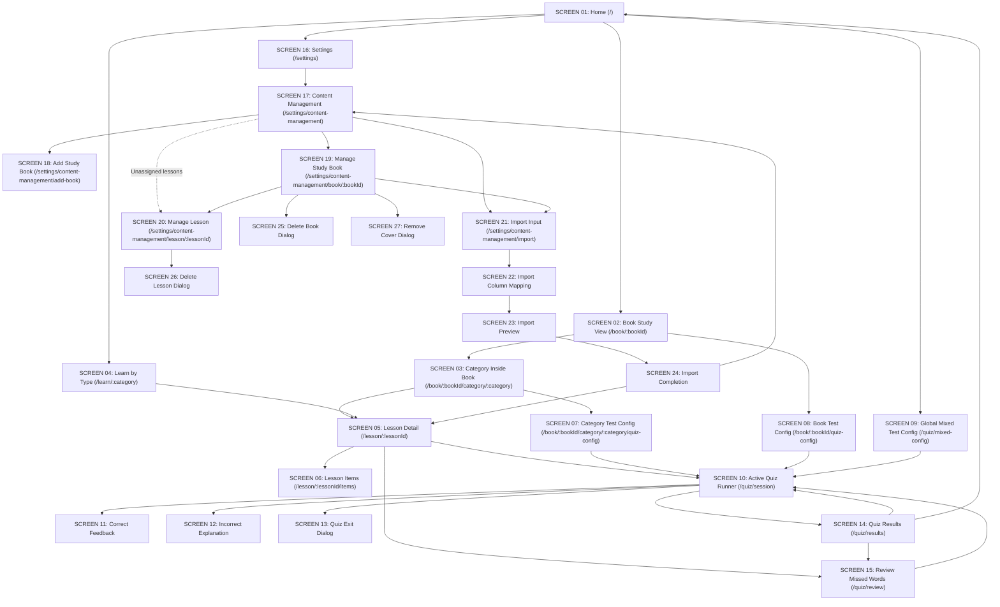

# Tango — Master Screen Specification & Route Architecture

This document is the authoritative master index, architectural route map, and responsive foundation for **Tango**. It establishes the screen inventory, platform invariants, breakpoint tiers, and route hierarchy, linking directly to domain-specific layout specifications.

> **Design System Reference:** All visual and interaction rules, tokens, Soft Claymorphism specifications, Light/Dark/Sakura themes, and typography are defined in [`docs/DESIGN_SYSTEM.md`](./DESIGN_SYSTEM.md). Every screen must follow its [Canonical Cross-Screen UI Baseline](./DESIGN_SYSTEM.md#canonical-cross-screen-ui-baseline); this document covers routes, breakpoints, and global structure only.
>
> **Domain Screen Specifications:**
> - [Study Screens (SCREEN 01 – 06)](./screens/STUDY_SCREENS.md)
> - [Quiz Configuration Screens (SCREEN 07 – 09)](./screens/QUIZ_CONFIG_SCREENS.md)
> - [Quiz Session Screens (SCREEN 10 – 15)](./screens/QUIZ_SESSION_SCREENS.md)
> - [Settings & Content Management Screens (SCREEN 16 – 20)](./screens/SETTINGS_CONTENT_SCREENS.md)
> - [Lesson Import Screens (SCREEN 21 – 24)](./screens/IMPORT_SCREENS.md)
> - [Destructive Dialog Screens (SCREEN 25 – 27)](./screens/DIALOG_SCREENS.md)

---

## 1. Platform Model & Canonical Breakpoints

Tango is built as **ONE unified responsive React Single Page Application (SPA) + Progressive Web App (PWA)**. There are no separate codebases or divergent interfaces for mobile, tablet, or desktop. A single responsive engine adapts fluidly across three canonical breakpoints:

| Breakpoint Tier | Viewport Width | Typical Hardware | Layout Strategy |
|---|---|---|---|
| **Mobile** | `< 640px` | Smartphones (iOS, Android, PWA installed on phone) | Single-column stacked flow, thumb-zone action placement, full-screen sub-routes, bottom sheets |
| **Tablet** | `640px – 1024px` | iPads, Android tablets, Foldables | 2-column content grids, centered modal dialogs, balanced ergonomic touch layout |
| **Desktop / Laptop** | `> 1024px` | Laptops, Desktops, PWA installed on macOS/Windows/Linux | Centered constrained canvas, 2–3 column browsing grids where meaningful, narrow focused quiz/study canvas, master-detail panels, keyboard-first navigation |

### Platform Invariants:
1. **PWA on Laptop / Desktop:** Runs in a standalone window utilizing the **Desktop / Laptop** layout (`max-w-2xl` for study, `max-w-4xl` for management).
2. **PWA on Mobile Phone:** Runs in a standalone window utilizing the **Mobile** layout with safe-area insets.
3. **Local-First Speed:** Instantaneous transitions via `localStorage` and `IndexedDB`. Spinners are used strictly for genuine asynchronous operations (file parsing, blob compression).

---

## 2. Global Navigation & Responsive Invariants

1. **Back Navigation Hierarchy:** Every sub-screen features an explicit top `[IconArrowLeft]` button returning predictably to its parent screen. Browser `popstate` closes open modals before navigating backwards.
2. **Safe-Area Insets:** Top headers incorporate `env(safe-area-inset-top)`; mobile bottom action bars incorporate `env(safe-area-inset-bottom)`.
3. **No Horizontal Scroll:** Viewports strictly enforce `overflow-x: hidden`. Cards and text wrap cleanly; short Japanese labels never wrap into vertical columns.
4. **Mobile First, Desktop Adapted:** Every screen is composed for mobile first and validated at ~360px and ~390px. Desktop/laptop is an intentional adaptation (centered constrained canvas, extra width used for meaningful columns), never a stretched mobile layout and never mobile as a shrunken desktop. See [baseline B8/B9](./DESIGN_SYSTEM.md#canonical-cross-screen-ui-baseline).
5. **Touch & Click Targets:** Standard action buttons have a minimum height of `48px`; quiz answer buttons have a minimum height of `56px`.
6. **No Visible Answer Hints:** Answer buttons strictly display **only** question content; no visible letters (`A/B/C/D`) or numbers (`1/2/3/4`) are stamped on the UI.
7. **Hard Deletion Only:** Deletions are irreversible; hard-delete cascades remove all references and Blob assets atomically (see [`docs/CONTENT_LIBRARY_SPEC.md`](./CONTENT_LIBRARY_SPEC.md)). Destructive actions reside exclusively in Content Management under Settings.
8. **Desktop Keyboard Accelerators:**
   - Multiple choice answer selection: Keys `1`, `2`, `3`, `4`.
   - Confirm / Advance / Dismiss: `Enter` or `Space`.
   - Exit / Cancel: `Escape`.
   - Open Settings from Home: `Alt+S`.
9. **Press & Hover Behavior:** All tactile controls use explicit press state (`usePressFeedback`), hover only on fine pointers, and cancel cleanly on drag-out; see [baseline B6](./DESIGN_SYSTEM.md#canonical-cross-screen-ui-baseline).

---

## 3. Reusable UI Components & Overlays

All screens compose a standardized set of Soft Claymorphism UI primitives specified in [`docs/DESIGN_SYSTEM.md`](./DESIGN_SYSTEM.md). Their clay level follows the [clay hierarchy (B5)](./DESIGN_SYSTEM.md#canonical-cross-screen-ui-baseline):
- **`TopBar`:** Restrained header with navigation wordmark, optional screen title, and settings icon. It never shows a theme status or theme control; theme selection lives only in Settings. A hard divider is optional; content scrolling beneath it may fade out through a soft page-colored feather.
- **`Button`:** Three roles. **Primary CTA** (one main action per screen): a visibly raised physical button on `--cta-*` with a solid depth lip (`--cta-depth`) that sinks onto the lip when pressed. **Neutral/Secondary** (`--bg-surface`): restrained clay with a 1px press sink. **Destructive** (`--error-surface`): restrained, never the raised primary treatment.
- **`AnswerOption`:** Positional choice button with Amber, Sky Blue, Violet, or Rose tint.
- **`CheckboxRow`:** Touch selection row with `IconSquare` / `IconSquareCheckFilled` and item count badge.
- **`SegmentedControl`:** Pill container with smooth sliding clay active pill.
- **`BottomSheet`:** Mobile-only bottom slide-up overlay with drag handle; the page behind is dimmed (optionally lightly blurred) while the sheet itself stays opaque.
- **`Modal`:** Centered opaque dialog (`max-w-md` to `max-w-lg`) over a dimmed (optionally lightly blurred) backdrop. Cancel holds initial focus.
- **`StickyBottomBar`:** Mobile-only affixed action bar respecting `env(safe-area-inset-bottom)`. Dissolves into normal document flow on Tablet/Desktop.
- **`EmptyState`:** Calming ceramic surface with Tabler icon, headline, and safe navigation link.

---

## 4. Master Screen Inventory & Route Map

### Detailed Screen Specifications by Domain:

| Domain | Included Screens | Authoritative Document |
|---|---|---|
| **Study & Exploration** | SCREEN 01 to SCREEN 06 | [`docs/screens/STUDY_SCREENS.md`](./screens/STUDY_SCREENS.md) |
| **Quiz Configuration** | SCREEN 07 to SCREEN 09 | [`docs/screens/QUIZ_CONFIG_SCREENS.md`](./screens/QUIZ_CONFIG_SCREENS.md) |
| **Quiz Runtime & Feedback** | SCREEN 10 to SCREEN 15 | [`docs/screens/QUIZ_SESSION_SCREENS.md`](./screens/QUIZ_SESSION_SCREENS.md) |
| **Settings & Administration** | SCREEN 16 to SCREEN 20 | [`docs/screens/SETTINGS_CONTENT_SCREENS.md`](./screens/SETTINGS_CONTENT_SCREENS.md) |
| **Lesson Import Pipeline** | SCREEN 21 to SCREEN 24 | [`docs/screens/IMPORT_SCREENS.md`](./screens/IMPORT_SCREENS.md) |
| **Destructive Dialogs** | SCREEN 25 to SCREEN 27 | [`docs/screens/DIALOG_SCREENS.md`](./screens/DIALOG_SCREENS.md) |

---

## 5. Loading, Async & Error Handling Specifications

1. **Local-First Performance:** Page loads, filtering, and study sessions are client-side and instantaneous.
2. **Asynchronous Operations:**
   - **XLSX / File Parsing:** Small ceramic spinner with text: *"Đang xử lý dữ liệu..."*.
   - **Cover Image Blob Compression:** Inline indicator: *"Đang lưu ảnh..."*.
3. **Validation Invariants:**
   - **Empty Book Title:** Red border + *"Vui lòng nhập tên giáo trình."*. Create CTA disabled.
   - **Cover Formats:** Supported strictly: `.jpg`, `.jpeg`, `.png`, `.webp`. Invalid warning: *"Chỉ hỗ trợ tệp ảnh .jpg, .jpeg, .png hoặc .webp."*.
   - **Import Formats:** Supported strictly: `.txt`, `.csv`, `.md`, `.xlsx` (matching [`docs/IMPORT_SPEC.md`](./IMPORT_SPEC.md)).
   - **$N = 0$ Quiz State:** If checked lessons yield 0 eligible questions, fixed count buttons are hidden, `Tất cả (0)` is not rendered, Start CTA is disabled, and warning shows: *"Không có câu hỏi phù hợp với các loại câu hỏi đã chọn."*.
   - **Storage Quota / Write Failures:** If a local write fails (e.g. browser quota exhausted), the screen shows a clear inline error next to the action (`Không thể lưu vào thiết bị...`) and the in-memory state is left unchanged.

---

## 6. Master Screen Coverage Matrix

| Screen ID | Screen Name | Mobile (< 640px) | Tablet (640px–1024px) | Desktop (> 1024px) | Empty State Handling | Keyboard Shortcuts | Destructive Actions | Detailed Specification |
|---|---|---|---|---|---|---|---|---|
| **SCREEN 01** | Home / Study Hub | Book-first: first 2 large book cards (+ `Xem tất cả`), then 2-col Vocabulary/Kanji shortcuts and a compact Test (+) CTA | 2-col book grid, shortcut row | 2-col book grid + one shortcut row (`max-w-4xl`) | Compact recessed shelf in the book area with link to Settings | `Enter` (open), `Alt+S` (settings) | None | [STUDY_SCREENS](./screens/STUDY_SCREENS.md#screen-01-home--study-hub) |
| **SCREEN 02** | Book Study View | Stacked cards + sticky CTA | Centered 2-col category row (`max-w-2xl`) | Centered 2-col category row (`max-w-2xl`) | Disabled category card if 0 lessons | `Esc` (back), `Enter` (test) | None | [STUDY_SCREENS](./screens/STUDY_SCREENS.md#screen-02-book-study-view) |
| **SCREEN 03** | Category View Inside Book | Full-width lesson list | 2-col lesson grid | 2-col lesson grid (`max-w-4xl`) | Empty message if 0 lessons in category | `Esc` (back) | None | [STUDY_SCREENS](./screens/STUDY_SCREENS.md#screen-03-category-view-inside-book) |
| **SCREEN 04** | Learn by Type | Stacked groups by book | 2-col grouped cards | 2-col grouped cards (`max-w-4xl`) | Message if no lessons exist | `Esc` (back) | None | [STUDY_SCREENS](./screens/STUDY_SCREENS.md#screen-04-learn-by-type-học-theo-loại) |
| **SCREEN 05** | Lesson Detail | Actions top + items below | Centered `max-w-2xl` | Centered `max-w-2xl` | N/A (valid lesson required) | `1`-`4` (actions), `Esc` (back) | None | [STUDY_SCREENS](./screens/STUDY_SCREENS.md#screen-05-lesson-detail) |
| **SCREEN 06** | View Lesson Items | Stacked item cards | 2-col cards | Table-like rows (`max-w-3xl`) | Message if lesson empty | `Esc` (back) | None | [STUDY_SCREENS](./screens/STUDY_SCREENS.md#screen-06-view-lesson-items-danh-sách-từ) |
| **SCREEN 07** | Category Multi-Lesson Config | Stacked list + sticky CTA | Centered `max-w-2xl` | Centered `max-w-2xl` | $N=0$ empty warning + disabled CTA | `Esc` (close), `Enter` (start) | None | [QUIZ_CONFIG_SCREENS](./screens/QUIZ_CONFIG_SCREENS.md#screen-07-category-multi-lesson-test-config) |
| **SCREEN 08** | Book Test Config | Stacked sections + sticky CTA | Centered 2-col (`max-w-3xl`) | Centered 2-col (`max-w-3xl`) | $N=0$ empty warning + disabled CTA | `Esc` (close), `Enter` (start) | None | [QUIZ_CONFIG_SCREENS](./screens/QUIZ_CONFIG_SCREENS.md#screen-08-book-test-config-kiểm-tra-giáo-trình) |
| **SCREEN 09** | Global Mixed Test | Stacked lists + sticky CTA | Centered 2-col (`max-w-4xl`) | Centered 2-col (`max-w-4xl`) | $N=0$ empty warning + disabled CTA | `Esc` (close), `Enter` (start) | None | [QUIZ_CONFIG_SCREENS](./screens/QUIZ_CONFIG_SCREENS.md#screen-09-global-mixed-test-kiểm-tra-tổng-hợp) |
| **SCREEN 10** | Active Quiz / Practice | Full-screen thumb zone | Centered `max-w-xl` | Centered canvas `max-w-xl` | Handled before launch | `1`-`4` (choice), `Esc` (exit) | None | [QUIZ_SESSION_SCREENS](./screens/QUIZ_SESSION_SCREENS.md#screen-10-active-quiz--practice-session) |
| **SCREEN 11** | Correct Answer Feedback | Emerald ring + auto-advance | Centered ring | Centered ring | N/A | `Enter`/`Space` (advance) | None | [QUIZ_SESSION_SCREENS](./screens/QUIZ_SESSION_SCREENS.md#screen-11-correct-answer-feedback) |
| **SCREEN 12** | Incorrect Explanation | Slide-up bottom sheet | Centered overlay | Centered overlay card | N/A | `Enter`/`Space` (continue) | None | [QUIZ_SESSION_SCREENS](./screens/QUIZ_SESSION_SCREENS.md#screen-12-incorrect-answer-feedback--explanation) |
| **SCREEN 13** | Quiz Exit Confirmation | Centered modal | Centered modal | Centered modal (`max-w-md`) | N/A | `Esc` (cancel), `Enter` (keep) | None | [QUIZ_SESSION_SCREENS](./screens/QUIZ_SESSION_SCREENS.md#screen-13-quiz-exit-confirmation) |
| **SCREEN 14** | Quiz Results Summary | 2x2 grid + stacked buttons | 4-col metric row | 4-col metrics (`max-w-2xl`) | N/A | `Enter` (review), `Esc` (home) | None | [QUIZ_SESSION_SCREENS](./screens/QUIZ_SESSION_SCREENS.md#screen-14-quiz-results-summary) |
| **SCREEN 15** | Review Missed Words | Reuses quiz runner | Reuses quiz runner | Reuses quiz runner | Message: "Không có từ cần ôn" | `1`-`4` (choice), `Esc` (exit) | None | [QUIZ_SESSION_SCREENS](./screens/QUIZ_SESSION_SCREENS.md#screen-15-review-missed-words-ôn-lại-từ-sai) |
| **SCREEN 16** | Settings | Full-screen route | Centered modal | Centered modal (`max-w-lg`) | N/A | `Esc` (close) | None | [SETTINGS_CONTENT_SCREENS](./screens/SETTINGS_CONTENT_SCREENS.md#screen-16-settings-cài-đặt) |
| **SCREEN 17** | Content Management | Stacked list (Books + Unassigned) | 2-col dashboard | 2-col dashboard (`max-w-4xl`) | Empty book list prompt | `Esc` (back) | None | [SETTINGS_CONTENT_SCREENS](./screens/SETTINGS_CONTENT_SCREENS.md#screen-17-content-management-quản-lý-nội-dung) |
| **SCREEN 18** | Add Study Book | Full-screen form route | Centered modal | Centered modal (`max-w-md`) | N/A | `Esc` (cancel), `Enter` (save) | None | [SETTINGS_CONTENT_SCREENS](./screens/SETTINGS_CONTENT_SCREENS.md#screen-18-add-study-book-thêm-giáo-trình) |
| **SCREEN 19** | Manage Study Book | Stacked overview + Danger | Centered 2-col | Centered 2-col (`max-w-4xl`) | Message if 0 lessons | `Esc` (back) | Danger Zone | [SETTINGS_CONTENT_SCREENS](./screens/SETTINGS_CONTENT_SCREENS.md#screen-19-manage-study-book-quản-lý-giáo-trình) |
| **SCREEN 20** | Manage Lesson | Stacked form + Danger | Centered form card | Centered card (`max-w-2xl`) | N/A | `Esc` (back), `Enter` (save) | Danger Zone | [SETTINGS_CONTENT_SCREENS](./screens/SETTINGS_CONTENT_SCREENS.md#screen-20-manage-lesson-quản-lý-bài-học) |
| **SCREEN 21** | Import Lesson: Input Stage | Stacked input form | Centered `max-w-2xl` | 2-section setup (`max-w-3xl`) | N/A | `Esc` (back) | None | [IMPORT_SCREENS](./screens/IMPORT_SCREENS.md#screen-21-add--import-lesson-input-stage-bước-1) |
| **SCREEN 22** | Import Column Mapping | Stacked dropdown cards | Centered table | Centered table (`max-w-3xl`) | N/A | `Esc` (back) | None | [IMPORT_SCREENS](./screens/IMPORT_SCREENS.md#screen-22-import-column-mapping--parsing-bước-2) |
| **SCREEN 23** | Import Preview & Validation | Stacked preview cards | Scrollable table | Scrollable table (`max-w-4xl`) | Shows 0 valid rows message | `Esc` (back), `Enter` (import) | None | [IMPORT_SCREENS](./screens/IMPORT_SCREENS.md#screen-23-import-preview--validation-bước-3) |
| **SCREEN 24** | Import Completion | Centered success card | Centered card | Centered card (`max-w-lg`) | N/A | `Enter` (open lesson) | None | [IMPORT_SCREENS](./screens/IMPORT_SCREENS.md#screen-24-import-result--completion-bước-4) |
| **SCREEN 25** | Delete Book Confirmation | Stacked buttons (16px gap) | Centered modal | Centered modal (`max-w-md`) | N/A | `Esc` (cancel) | HARD DELETE | [DIALOG_SCREENS](./screens/DIALOG_SCREENS.md#screen-25-delete-study-book-confirmation) |
| **SCREEN 26** | Delete Lesson Confirmation | Stacked buttons (16px gap) | Centered modal | Centered modal (`max-w-md`) | N/A | `Esc` (cancel) | HARD DELETE | [DIALOG_SCREENS](./screens/DIALOG_SCREENS.md#screen-26-delete-lesson-confirmation) |
| **SCREEN 27** | Remove Cover Confirmation | Stacked buttons (16px gap) | Centered modal | Centered modal (`max-w-md`) | N/A | `Esc` (cancel) | Non-destructive | [DIALOG_SCREENS](./screens/DIALOG_SCREENS.md#screen-27-remove-cover-confirmation) |
